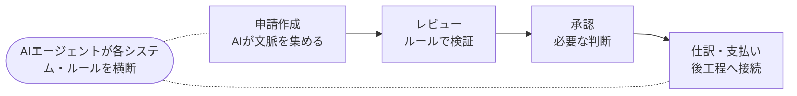

# レビューを売り続けながら、Autopilotは「一体化した将来像」へ寄せる

> MTG｜Autopilotの提供価値とAI申請レビューの棲み分け（2026-09-30）
> 元ファイル: [20260930_MTG.html](./20260930_MTG.html)（バクラク セールスAI で作成）。`[mm:ss]` は録音の該当箇所へのリンク。

短期はAI申請レビューを販売継続し、Autopilotの無償・過度な拡大は止める。中長期は、申請作成からレビュー・承認・仕訳までを、AIによるエンドツーエンドの体験として統合する方向で整理された。[[48:42]](https://sales-ai.layerx.jp/s/recording/01M3R40Q292JS487Q5TQV6B94J?t=2922780&src=summary)

## 主要な数字

| 数値 | 内容 |
| --- | --- |
| **25社** | Autopilotで合意した社数の目安 [[04:43]](https://sales-ai.layerx.jp/s/recording/01M3R40Q292JS487Q5TQV6B94J?t=283860&src=summary) |
| **75社** | AMチーム側に置かれていたAutopilot受注目標 [[05:32]](https://sales-ai.layerx.jp/s/recording/01M3R40Q292JS487Q5TQV6B94J?t=332640&src=summary) |
| **163件** | AI申請レビューの受注数として共有された実績 [[21:52]](https://sales-ai.layerx.jp/s/recording/01M3R40Q292JS487Q5TQV6B94J?t=1312800&src=summary) |
| **30〜40件/月** | AI申請レビューの新規販売ペース [[21:52]](https://sales-ai.layerx.jp/s/recording/01M3R40Q292JS487Q5TQV6B94J?t=1312800&src=summary) |

## 決まった方向と次の動き

- **【決定】AI申請レビューは売り続ける** — レビュー単体の販売は継続し、Autopilotを理由に止めない。[[48:42]](https://sales-ai.layerx.jp/s/recording/01M3R40Q292JS487Q5TQV6B94J?t=2922780&src=summary)
- **【方針】Autopilotの無償販売をやめる** — 半年無料を前提にした売り方は見直し、直近の価格を下げる案を含めて有償化・キャパシティ管理を進める。[[49:02]](https://sales-ai.layerx.jp/s/recording/01M3R40Q292JS487Q5TQV6B94J?t=2942160&src=summary)
- **【次アクション】CS向けに方針を共有する** — 会議内容を3〜4枚程度の資料にまとめ、CSチーム向けの勉強会を企画する。担当は発言上、自分と今さんで進める想定。[[57:32]](https://sales-ai.layerx.jp/s/recording/01M3R40Q292JS487Q5TQV6B94J?t=3452940&src=summary)
- **【再整理】ビジョンと現在の売り方を分けて説明する** — 「レビューを売る」と「将来Autopilotへ統合する」を、トレードオフではなく段階として社内外に伝える。[[51:45]](https://sales-ai.layerx.jp/s/recording/01M3R40Q292JS487Q5TQV6B94J?t=3105780&src=summary)

## 議論の構造

| 論点 | 議論されたこと | 到達点 |
| --- | --- | --- |
| 拡大ペース | 無料で進めると顧客価値が曖昧なまま、経営層と現場の期待差やオペレーター不足が広がる懸念が出た。[[04:54]](https://sales-ai.layerx.jp/s/recording/01M3R40Q292JS487Q5TQV6B94J?t=294960&src=summary) | 社数目標より、PMFに必要な顧客数と成功体験を優先。20〜30社でもよく、100社にこだわらない。[[21:06]](https://sales-ai.layerx.jp/s/recording/01M3R40Q292JS487Q5TQV6B94J?t=1266000&src=summary) |
| レビューと承認 | 申請時のリアルタイムレビューと、承認時の重いチェックは性質が異なるため、機能は切り分けつつサービス体験は一体化したいという意見が出た。[[14:45]](https://sales-ai.layerx.jp/s/recording/01M3R40Q292JS487Q5TQV6B94J?t=885300&src=summary) | レビューを入口にし、将来は自動承認・申請作成へ段階的に広げる。[[53:22]](https://sales-ai.layerx.jp/s/recording/01M3R40Q292JS487Q5TQV6B94J?t=3202260&src=summary) |
| 顧客タイプ | 業務を丸投げしたい顧客と、ルールやAIの動作を自分で確認したい顧客では、求める体験が異なる。現在の顧客は後者が中心との見立てが示された。[[12:56]](https://sales-ai.layerx.jp/s/recording/01M3R40Q292JS487Q5TQV6B94J?t=776580&src=summary) | まず現在フィットしているレビュー体験を担保し、顧客ニーズに応じて次の段階へ進める。[[12:04]](https://sales-ai.layerx.jp/s/recording/01M3R40Q292JS487Q5TQV6B94J?t=724140&src=summary) |
| ルール設計 | 現状はルールの羅列になっており、会社全体の「黄金ルール」や優先順位を持つ場所が不足している。[[27:51]](https://sales-ai.layerx.jp/s/recording/01M3R40Q292JS487Q5TQV6B94J?t=1671180&src=summary) | 申請作成・レビュー・承認・仕訳でルールを分断せず、AIが扱える共通ルールとして実験する方向。詳細設計は継続。[[43:09]](https://sales-ai.layerx.jp/s/recording/01M3R40Q292JS487Q5TQV6B94J?t=2589960&src=summary) |

## 提供価値の整理

申請作成側は自由度の高いAIエージェント、後工程はゴールデンルールによるガバナンスとして分け、最終的には一体の体験にする構想。[[45:40]](https://sales-ai.layerx.jp/s/recording/01M3R40Q292JS487Q5TQV6B94J?t=2740020&src=summary)

## 重要な前提・懸念

- 無料で顧客数だけを増やすことには価値がなく、顧客が価値を感じてサクセスしていることを先に確認すべき。[[06:45]](https://sales-ai.layerx.jp/s/recording/01M3R40Q292JS487Q5TQV6B94J?t=405840&src=summary)
- AI申請レビューはリアルタイム性があるため、重い承認チェックを同じ画面に詰め込むと申請者体験や生産性を損なう可能性がある。[[13:59]](https://sales-ai.layerx.jp/s/recording/01M3R40Q292JS487Q5TQV6B94J?t=839460&src=summary)
- 既存のAI申請レビュー契約を将来の統合プロダクトへ移行する際、ID課金とタスク量・成果課金の差、既存顧客のオンボーディング負担、価格移行が課題になる。[[25:07]](https://sales-ai.layerx.jp/s/recording/01M3R40Q292JS487Q5TQV6B94J?t=1507380&src=summary)
- 請求書支払いは顧客ごとの業務差が大きく、経費精算とは成熟度や進め方が異なる。経費精算は、レビューから将来のエンドツーエンド体験へ進めやすい領域として位置づけられた。[[54:33]](https://sales-ai.layerx.jp/s/recording/01M3R40Q292JS487Q5TQV6B94J?t=3273780&src=summary)

## 会議後半で確認された別件

後半では顧客とのAI申請承認POCについて、実施可否・スコープ・実績を確認する打ち合わせが開始された。目黒様・平野様が参加し、今井様は遅れて参加予定。質問票に基づき、申請レビューのルール自動提案機能の利用内容を確認するところで録音が終了している。[[1:03:12]](https://sales-ai.layerx.jp/s/recording/01M3R40Q292JS487Q5TQV6B94J?t=3792120&src=summary)
