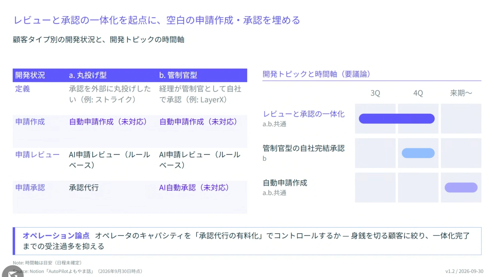

# レビューと承認の一体化を起点に、空白の申請作成・承認を埋める

顧客タイプ別の開発状況と、開発トピックの時間軸

## 顧客タイプ別の開発状況

| 開発状況 | a. 丸投げ型 | b. 管制官型 |
| --- | --- | --- |
| 定義 | 承認を外部に丸投げしたい（例: ストライク） | 経理が管制官として自社で承認（例: LayerX） |
| 申請作成 | 自動申請作成（未対応） | 自動申請作成（未対応） |
| 申請レビュー | AI申請レビュー（ルールベース） | AI申請レビュー（ルールベース） |
| 申請承認 | 承認代行 | AI自動承認（未対応） |

## 開発トピックと時間軸（要議論）

| 開発トピック | 対象 | 3Q | 4Q | 来期〜 |
| --- | --- | :---: | :---: | :---: |
| レビューと承認の一体化 | a.b.共通 | ● | ● | |
| 管制官型の自社完結承認 | b | | ● | |
| 自動申請作成 | a.b.共通 | | | ● |

## オペレーション論点

オペレータのキャパシティを「承認代行の有料化」でコントロールするか — 身銭を切る顧客に絞り、一体化完了までの受注過多を抑える

---

- Note: 時間軸は目安（日程未確定）
- Source: Notion「AutoPilotよもやま話」（2026年9月30日時点）
- v1.2 / 2026-09-30
